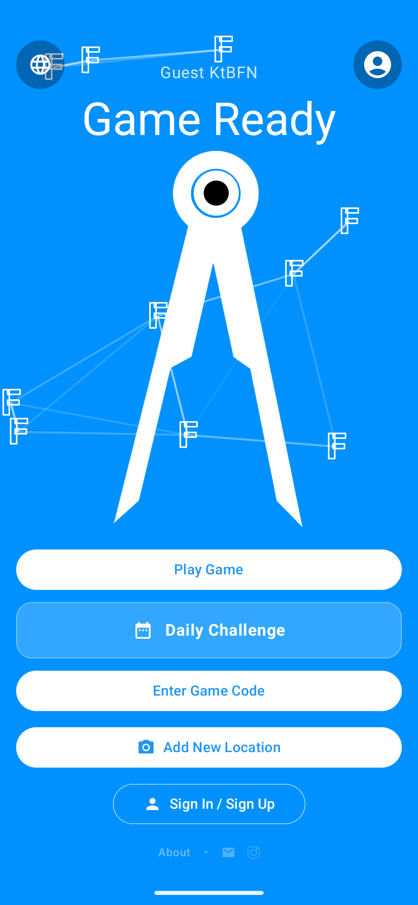
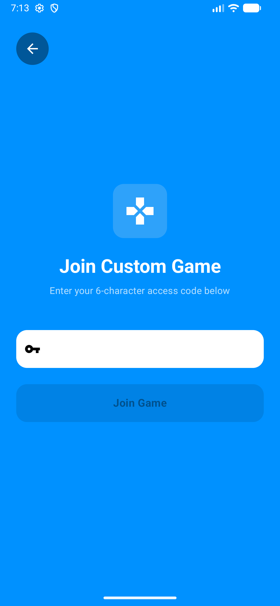
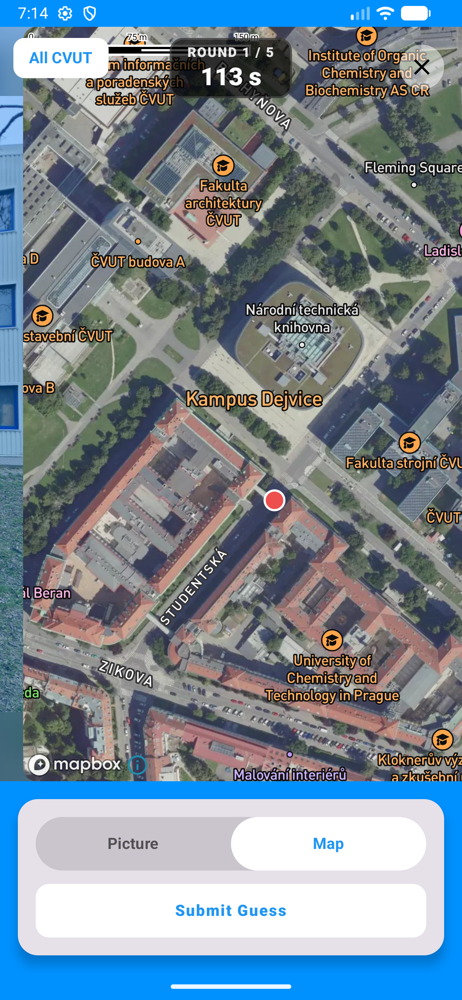
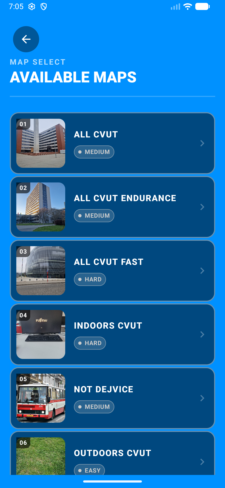
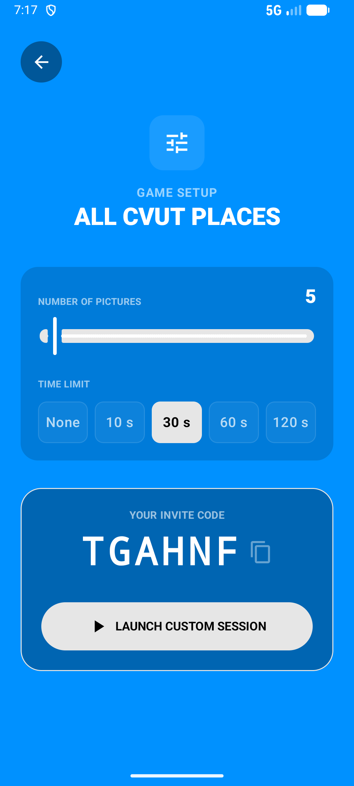
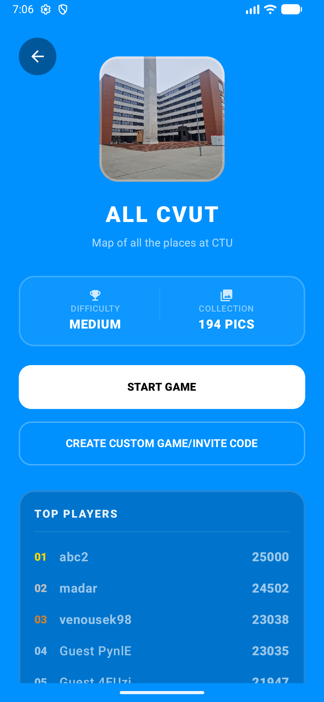
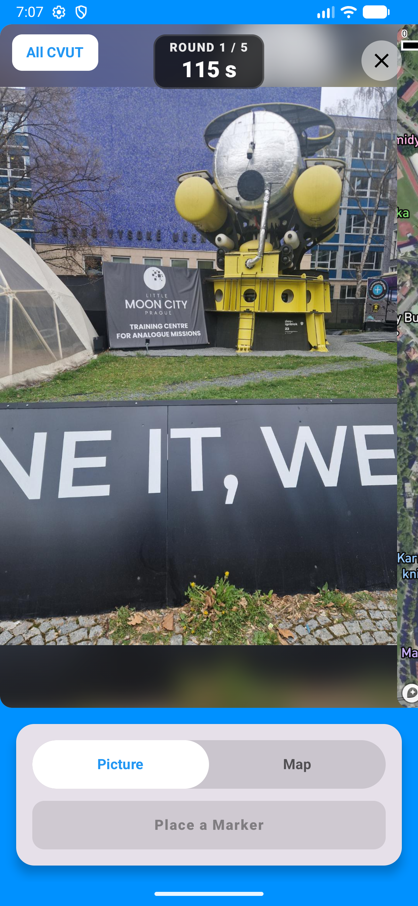
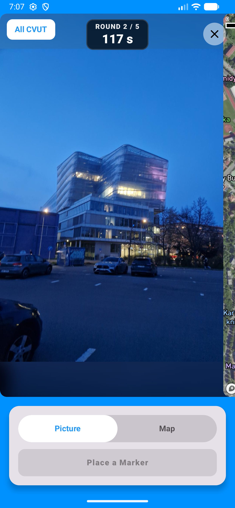
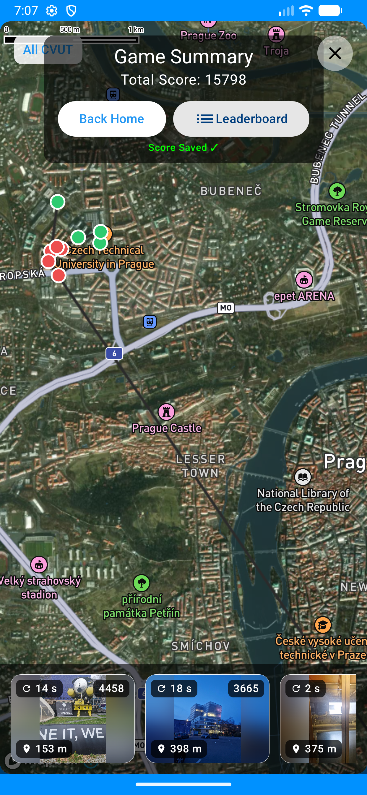

# CVUTGuessr

Source code-less readme of the diploma thesis CVUTGuessr.
A location guessing game on and around CTU campus.

Built in Kotlin Multiplatform for Android and iOS.
You will need to provide a link to your private MapBox key and register the app with your Firebase account
to run locally.
After that it should be runnable from either platform's usual start points (green play button in Android Studio/IntelliJ
and run in XCode).

Gameplay screenshots:
## 🎮 Gameplay Showcase

| | | |
|:---:|:---:|:---:|
|  |  |  |
|  |  |  |
|  |  |  |
